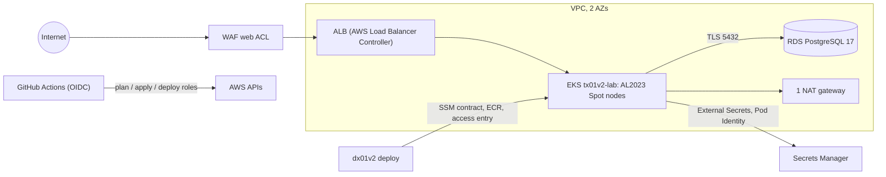

# tx01v2

AWS infrastructure half of a DevOps lab: Terraform, EKS, RDS, ALB + WAF and GitHub Actions with OIDC.

[](https://github.com/maringelix/tx01v2/actions/workflows/ci.yml)

[Português](README.pt-BR.md)

## What is this

A public, educational lab you can clone or fork to learn how a small EKS platform is built, tested
and torn down safely. Everything is checked by a local harness that needs no cloud account; the
cloud path is optional and costs money. **v2 has never been applied to AWS** — the status matrix
below says exactly what is proven and how.

The lab family (v2):

| Repository | Cloud | Role | Status |
|---|---|---|---|
| `tx01v2` (this repo) | AWS | infrastructure (Terraform, platform layer) | see status matrix |
| [`dx01v2`](https://github.com/maringelix/dx01v2) | AWS | application (built against `docs/CONTRATO.md`) | see its status matrix |
| [`tx02v2`](https://github.com/maringelix/tx02v2) | Azure | infrastructure (Terraform, AKS, PostgreSQL Flexible Server, Application Gateway for Containers) | see its status matrix |
| [`dx02v2`](https://github.com/maringelix/dx02v2) | Azure | application (the dx01v2 app on AKS) | see its status matrix |
| [`tx03v2`](https://github.com/maringelix/tx03v2) | GCP | infrastructure (Terraform, GKE Autopilot, Cloud SQL, Cloud Armor) | see its status matrix |
| [`dx03v2`](https://github.com/maringelix/dx03v2) | GCP | application (the dx01v2 app on GKE Autopilot) | see its status matrix |

## Status matrix

| Capability | Status | Evidence |
|---|---|---|
| Formatting, validation, provider lock files (4 platforms) | `verified in CI` | `make static` (`terraform-fmt`, `terraform-validate:*`, `terraform-lockfiles`); CI job `static` |
| Lint and IaC security scan (tflint, trivy HIGH/CRITICAL) | `verified in CI` | `make static` (`tflint`, `trivy-config`, `trivy-config-tfvars`) |
| Workflows, scripts, Kubernetes manifests and Helm values (actionlint, shellcheck, kubeconform, helm template) | `verified in CI` | `make static` |
| Secret scan and repository policies (no real identifiers, pinned actions, v1 regressions) | `verified in CI` | `make static` (`gitleaks`, `policy-*`, `repo-structure`) |
| Terraform unit tests with a mocked AWS provider (OIDC trust, bucket, budget, EKS, nodes, RDS, ECR, WAF, KMS, contract SSM parameters, negative validations) | `verified in CI` | `make test`; CI job `test` |
| Bootstrap (state bucket, GitHub OIDC roles, budget) | `not run in the cloud (v2)` | `terraform/bootstrap`, `docs/RUNBOOK.md` |
| Lab apply (VPC, EKS 1.36, RDS PostgreSQL 17, ECR, WAF, SSM contract) | `not run in the cloud (v2)` | `.github/workflows/terraform-apply.yml` |
| Plan on pull requests | `not run in the cloud (v2)` | `.github/workflows/terraform-plan.yml` |
| Platform layer (AWS Load Balancer Controller v3.6.0, External Secrets Operator 2.12.0) | `not run in the cloud (v2)` | `.github/workflows/platform.yml`, `platform/install.sh` |
| Destroy + leftover check | `not run in the cloud (v2)` | `.github/workflows/terraform-destroy.yml`, `scripts/leftovers.sh` |
| Repository settings as code (ruleset, environment `lab`) | `verified locally` | `scripts/repo-guardrails.sh` applied; read back with `gh api` on 2026-10-13 (`docs/PUBLICACAO.md`) |
| **Local lab** (Terraform on Docker): kind cluster + emulated ECR, RDS (TLS only), S3, load balancer, git server; destroy + leftover check | `verified locally` | `make e2e` (`terraform/envs/local`, `scripts/local-lab.sh`); `terraform-test:envs/local` |
| Service mesh: Istio 1.31 ambient, mTLS `STRICT`, identity-based `AuthorizationPolicy` | `verified locally` | `make e2e` (`platform/local/check.sh`: allowed, other identity and plaintext probes) |
| Gateway API on Istio behind the emulated load balancer, HTTPS with cert-manager (lab CA), HTTP → HTTPS | `verified locally` | `make e2e` |
| External Secrets (ClusterSecretStore `local-secrets`), metrics-server | `verified locally` | `make e2e` |
| Observability: Prometheus, Alertmanager (synthetic alert delivered), Grafana (ClusterIP), Loki + Alloy | `verified locally` | `make e2e`; `helm-template-local` |
| GitOps with Argo CD 3.5 (commit → sync → self-heal from the lab git server) | `verified locally` | `make e2e` |
| Policy as code: Gatekeeper 3.23 in `deny` (allowed registries, pinned images, resources, probes, labels, NodePort) | `verified locally` | `policy-gator` (`gator verify`); `make e2e` |
| In-cluster scanning: Trivy Operator (vulnerability and configuration reports) | `verified locally` | `make e2e` |
| Backup and restore drill: Velero to the S3 emulator (namespace deleted, restored with its data) | `verified locally` | `make e2e` |
| Chaos engineering with a hypothesis: Chaos Mesh pod-kill, availability measured | `verified locally` | `make e2e` |
| The same add-ons on EKS | `planned` | the local platform shows the target; the cloud platform layer installs only LBC + ESO |

`verified in CI` rows run on every pull request, on every push to `main` and weekly (CI jobs
`static` and `test`). A cloud row changes only with a `cloud_run_report` issue (date, region,
commit, cost, leftovers). The local lab rows run in the CI job `e2e` too.

## Architecture



- `terraform/bootstrap`: S3 state bucket (native locking), GitHub OIDC provider and the three contract
  roles, monthly cost budget. Applied once, locally, by a human.
- `terraform/envs/lab`: modules `kms`, `network`, `eks`, `rds`, `ecr`, `waf`, the admin-token secret
  and the SSM parameters dx01v2 reads.
- `platform/`: Helm charts and manifests installed after the apply, never by Terraform.
- Design decisions and the v1 → v2 table: [docs/ARQUITETURA.md](docs/ARQUITETURA.md).

## Quick start (free, local)

You need Docker (devcontainer) or Linux/WSL 2 with bash >= 4.4, curl, unzip, xz, git and make.

```bash
git clone https://github.com/maringelix/tx01v2.git && cd tx01v2
make tools                     # pinned tools into .tools/, SHA256-verified
HARNESS_STRICT=1 make verify   # every static check + terraform test
make help
```

On Windows or macOS, open the folder in the devcontainer (`.devcontainer/devcontainer.json`); it
runs `make tools` for you. Nothing here touches AWS.

### The whole lab on your machine (free)

The v1 lab ran its platform (mesh, monitoring, GitOps, policies, scanning, backup, chaos) only in
the cloud. The local lab builds the same platform on Docker, so you can study and break it without
an account:

```bash
make e2e            # up + every probe + down: about 30-40 minutes, 8 GB of Docker memory for "full"
make local-up       # or keep it running (LOCAL_PROFILE=core|observability|operations|full)
make local-check    # probes against the running lab
make local-down     # destroy + leftover check
```

| AWS (cloud path) | Local lab |
|---|---|
| EKS 1.36 | kind 1.36 (`terraform/envs/local`) |
| ECR | registry (`registry.tx01v2.local`, push to `localhost:5001`) |
| RDS PostgreSQL 17, TLS `verify-full` | PostgreSQL 17, TLS only, lab CA |
| ALB + AWS Load Balancer Controller | cloud-provider-kind + Istio Gateway (Gateway API) |
| ACM | cert-manager, ClusterIssuer `lab-ca` |
| Secrets Manager + ESO | Secrets of `lab-secrets` + ESO |
| S3 (backups) | Versity S3 Gateway |
| SSM contract | ConfigMap `lab-system/lab-contract` (`docs/CONTRATO.md`) |
| GitHub (GitOps source) | Soft Serve git server |

Details, probes and limits: [docs/LAB_LOCAL.md](docs/LAB_LOCAL.md) and
[docs/ARQUITETURA.md](docs/ARQUITETURA.md). dx01v2 deploys the app on top of it (`make e2e-platform`
there).

## Cloud path (costs money)

**Cost first:** about US$0.26–0.32 per hour in us-east-1 with the defaults (reference list prices,
see [docs/CUSTOS.md](docs/CUSTOS.md)). A forgotten lab costs more than US$40 per week. Use a
dedicated AWS account, keep the budget alerts, and destroy on the same day.

Follow [docs/RUNBOOK.md](docs/RUNBOOK.md): bootstrap → GitHub variables → apply → platform → deploy
dx01v2 → smoke test → destroy → leftover check → `cloud_run_report` issue.

## Harness

| Target | What it runs | When |
|---|---|---|
| `make help` | lists the targets | any time |
| `make tools` | `scripts/install-tools.sh`: terraform 1.16.5, tflint 0.64.0 + aws ruleset 0.49.0, trivy 0.75.0, actionlint 1.7.12, shellcheck 0.11.0, kubeconform 0.8.0, gitleaks 8.30.1, kubectl 1.37.1, helm 4.3.0, kind 0.33.0, gator 3.23.1 | once, and after a tool bump |
| `make static` | `scripts/harness.sh static` | before every push |
| `make test` | `scripts/harness.sh test` (`terraform test`, mocked providers) | before every push |
| `make verify` | static + test (CI jobs `static` and `test`) | before every PR |
| `make e2e` | `scripts/harness.sh e2e`: the local lab end to end (CI job `e2e`) | platform or local lab changes |
| `make all` | static + test + e2e | — |
| `make clean` | removes `.tools/`, caches and Terraform working dirs | — |

`scripts/harness.sh list` prints every check. Details: [docs/HARNESS.md](docs/HARNESS.md).

## Docs

All docs are in Brazilian Portuguese.

| Doc | Content |
|---|---|
| [docs/ARQUITETURA.md](docs/ARQUITETURA.md) | diagram, ADRs, v1 → v2 |
| [docs/CONTRATO.md](docs/CONTRATO.md) | tx01v2 ⇄ dx01v2 contract v1 (source of truth) |
| [docs/RUNBOOK.md](docs/RUNBOOK.md) | full cloud round |
| [docs/LAB_LOCAL.md](docs/LAB_LOCAL.md) | the local lab: what is emulated, how to run it, probes, limits |
| [docs/CUSTOS.md](docs/CUSTOS.md) | cost estimate per component |
| [docs/GUARDRAILS.md](docs/GUARDRAILS.md) | rules, enforcement, exceptions, limits |
| [docs/HARNESS.md](docs/HARNESS.md) | checks, strict mode, troubleshooting |
| [docs/SUSTENTACAO.md](docs/SUSTENTACAO.md) | routines, end-of-support calendar, update procedures |
| [docs/PUBLICACAO.md](docs/PUBLICACAO.md) | checklist to make the repository public |
| [docs/LICOES_APRENDIDAS.md](docs/LICOES_APRENDIDAS.md) | lessons learned from v1 |

## Contributing

Read [CONTRIBUTING.md](CONTRIBUTING.md) and [AGENTS.md](AGENTS.md) (also for humans). Security
issues: [SECURITY.md](SECURITY.md).

## License

[MIT](LICENSE) — Copyright (c) 2025-2026 Bruno Maringeli.
