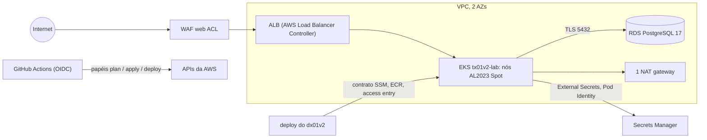

# tx01v2

Metade de infraestrutura AWS de um lab de DevOps: Terraform, EKS, RDS, ALB + WAF e GitHub Actions com OIDC.

[](https://github.com/maringelix/tx01v2/actions/workflows/ci.yml)

[English](README.md)

## O que é

Um lab público e educacional para clonar ou fazer fork e aprender como uma plataforma EKS pequena é
construída, testada e destruída com segurança. Tudo é verificado por um harness local que não precisa
de conta na nuvem; o caminho em nuvem é opcional e custa dinheiro. **A v2 nunca foi aplicada na AWS**
— a matriz de status abaixo diz exatamente o que está provado e como.

A família do lab (v2):

| Repositório | Nuvem | Papel | Status |
|---|---|---|---|
| `tx01v2` (este repositório) | AWS | infraestrutura (Terraform, camada de plataforma) | ver matriz de status |
| [`dx01v2`](https://github.com/maringelix/dx01v2) | AWS | aplicação (construída sobre o `docs/CONTRATO.md`) | veja a matriz de status dele |
| `tx02v2` / `dx02v2` | Azure | infraestrutura / aplicação | `planejado` |
| `tx03v2` / `dx03v2` | GCP | infraestrutura / aplicação | `planejado` |

## Matriz de status

| Capacidade | Status | Evidência |
|---|---|---|
| Formatação, validação, lock files de providers (4 plataformas) | `verificado no CI` | `make static` (`terraform-fmt`, `terraform-validate:*`, `terraform-lockfiles`); job `static` do CI |
| Lint e scan de segurança da IaC (tflint, trivy HIGH/CRITICAL) | `verificado no CI` | `make static` (`tflint`, `trivy-config`, `trivy-config-tfvars`) |
| Workflows, scripts, manifests Kubernetes e values do Helm (actionlint, shellcheck, kubeconform, helm template) | `verificado no CI` | `make static` |
| Scan de segredos e políticas do repositório (sem identificadores reais, actions fixadas, regressões do v1) | `verificado no CI` | `make static` (`gitleaks`, `policy-*`, `repo-structure`) |
| Testes unitários do Terraform com provider AWS mockado (trust OIDC, bucket, budget, EKS, nós, RDS, ECR, WAF, KMS, parâmetros SSM do contrato, validações negativas) | `verificado no CI` | `make test`; job `test` do CI |
| Bootstrap (bucket de state, papéis OIDC do GitHub, budget) | `não executado em nuvem (v2)` | `terraform/bootstrap`, `docs/RUNBOOK.md` |
| Apply do lab (VPC, EKS 1.36, RDS PostgreSQL 17, ECR, WAF, contrato no SSM) | `não executado em nuvem (v2)` | `.github/workflows/terraform-apply.yml` |
| Plan em pull requests | `não executado em nuvem (v2)` | `.github/workflows/terraform-plan.yml` |
| Camada de plataforma (AWS Load Balancer Controller v3.6.0, External Secrets Operator 2.12.0) | `não executado em nuvem (v2)` | `.github/workflows/platform.yml`, `platform/install.sh` |
| Destroy + checagem de sobras | `não executado em nuvem (v2)` | `.github/workflows/terraform-destroy.yml`, `scripts/leftovers.sh` |
| Configurações do repositório como código (ruleset, environment `lab`) | `planejado` | `scripts/repo-guardrails.sh`, `docs/PUBLICACAO.md` |

As linhas `verificado no CI` rodam em todo pull request, em todo push para a `main` e toda semana
(jobs `static` e `test` do CI). Uma linha de nuvem só muda com uma issue `cloud_run_report` (data,
região, commit, custo, sobras).

## Arquitetura



- `terraform/bootstrap`: bucket S3 de state (lock nativo), provider OIDC do GitHub e os três papéis do
  contrato, budget mensal. Aplicado uma vez, localmente, por um humano.
- `terraform/envs/lab`: módulos `kms`, `network`, `eks`, `rds`, `ecr`, `waf`, o segredo do token de
  admin e os parâmetros SSM que o dx01v2 lê.
- `platform/`: charts Helm e manifests instalados depois do apply, nunca pelo Terraform.
- Decisões de design e a tabela v1 → v2: [docs/ARQUITETURA.md](docs/ARQUITETURA.md).

## Início rápido (grátis, local)

Você precisa de Docker (devcontainer) ou Linux/WSL 2 com bash >= 4.4, curl, unzip, xz, git e make.

```bash
git clone https://github.com/maringelix/tx01v2.git && cd tx01v2
make tools                     # ferramentas fixadas em .tools/, SHA256 conferido
HARNESS_STRICT=1 make verify   # todos os checks estáticos + terraform test
make help
```

No Windows ou macOS, abra a pasta no devcontainer (`.devcontainer/devcontainer.json`); ele roda
`make tools` sozinho. Nada aqui toca a AWS.

## Caminho em nuvem (custa dinheiro)

**Custo primeiro:** cerca de US$0,26–0,32 por hora em us-east-1 com os padrões (preços de tabela de
referência, ver [docs/CUSTOS.md](docs/CUSTOS.md)). Um lab esquecido custa mais de US$40 por semana.
Use uma conta AWS dedicada, mantenha os alertas do budget e destrua no mesmo dia.

Siga o [docs/RUNBOOK.md](docs/RUNBOOK.md): bootstrap → variáveis do GitHub → apply → plataforma →
deploy do dx01v2 → smoke test → destroy → checagem de sobras → issue `cloud_run_report`.

## Harness

| Alvo | O que roda | Quando |
|---|---|---|
| `make help` | lista os alvos | a qualquer momento |
| `make tools` | `scripts/install-tools.sh`: terraform 1.16.5, tflint 0.64.0 + ruleset aws 0.49.0, trivy 0.75.0, actionlint 1.7.12, shellcheck 0.11.0, kubeconform 0.8.0, gitleaks 8.30.1, kubectl 1.37.1, helm 4.3.0 | uma vez, e depois de atualizar uma ferramenta |
| `make static` | `scripts/harness.sh static` | antes de cada push |
| `make test` | `scripts/harness.sh test` (`terraform test`, provider AWS mockado) | antes de cada push |
| `make verify` | static + test (o que o CI roda) | antes de cada PR |
| `make all` | todos os estágios (aqui, igual ao verify) | — |
| `make clean` | remove `.tools/`, caches e diretórios de trabalho do Terraform | — |

`scripts/harness.sh list` mostra todos os checks. Detalhes: [docs/HARNESS.md](docs/HARNESS.md).

## Documentação

| Documento | Conteúdo |
|---|---|
| [docs/ARQUITETURA.md](docs/ARQUITETURA.md) | diagrama, ADRs, v1 → v2 |
| [docs/CONTRATO.md](docs/CONTRATO.md) | contrato tx01v2 ⇄ dx01v2 v1 (fonte da verdade) |
| [docs/RUNBOOK.md](docs/RUNBOOK.md) | rodada completa na nuvem |
| [docs/CUSTOS.md](docs/CUSTOS.md) | estimativa de custo por componente |
| [docs/GUARDRAILS.md](docs/GUARDRAILS.md) | regras, aplicação, exceções, limites |
| [docs/HARNESS.md](docs/HARNESS.md) | checks, modo estrito, problemas comuns |
| [docs/SUSTENTACAO.md](docs/SUSTENTACAO.md) | rotinas, calendário de fim de suporte, procedimentos de atualização |
| [docs/PUBLICACAO.md](docs/PUBLICACAO.md) | checklist para tornar o repositório público |
| [docs/LICOES_APRENDIDAS.md](docs/LICOES_APRENDIDAS.md) | lições aprendidas com o v1 |

## Contribuindo

Leia o [CONTRIBUTING.md](CONTRIBUTING.md) e o [AGENTS.md](AGENTS.md) (também para humanos).
Vulnerabilidades: [SECURITY.md](SECURITY.md).

## Licença

[MIT](LICENSE) — Copyright (c) 2025-2026 Bruno Maringeli.
