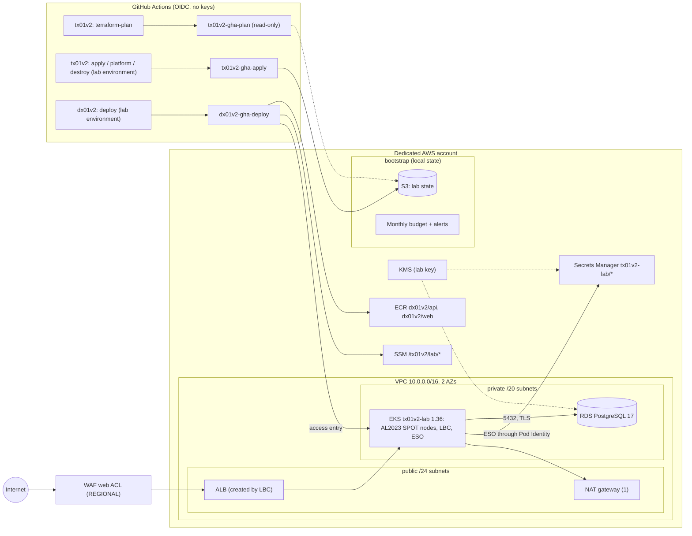
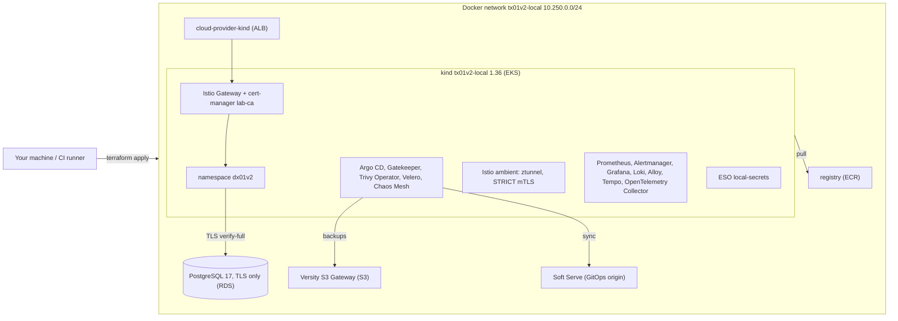

# tx01v2 architecture

> Decision tables and lessons preserve the initial state of each delivery. Current HA/backup/
> PITR/DR scope is in [CONTINUITY.md](CONTINUITY.md); capacity, OpenCost/VPA/Spot and estimates are
> in [FINOPS.md](FINOPS.md). Earlier out-of-scope decisions do not revoke subsequent R7–R10 work.

AWS lab infrastructure, its decisions in short ADRs and differences from v1. Nothing has been
applied in AWS v2: `not run in the cloud (v2)`. Referenced tests/checks cover configuration.
The diagram shows the primary baseline; the independent DR runtime is described in continuity.

## Diagram

Layers: `terraform/bootstrap`, once by a human → `terraform/envs/lab`, modules `kms`, `network`,
`eks`, `rds`, `ecr`, `velero` and `waf` → `platform/`, Helm/manifests outside Terraform →
the dx01v2 app. [CONTRACT.md](CONTRACT.md) defines their interface.

## Local lab

Docker emulates the architecture through `terraform/envs/local` and `platform/local`, with the
complete platform derived from v1. Details, probes and limits: [LOCAL_LAB.md](LOCAL_LAB.md).

## Decisions: short ADRs

| # | Decision | Reason | Rejected alternative |
|---|---|---|---|
| 1 | EKS Pod Identity for LBC, ESO and Collector | No per-cluster OIDC provider; `pods.eks.amazonaws.com` trust scoped by `aws:SourceAccount`/`aws:SourceArn` | IRSA with OIDC provider and service-account-subject trust |
| 2 | No Kubernetes/Helm Terraform providers | State does not depend on cluster API availability; destroy is not blocked by Kubernetes resources | Helm through Terraform, coupling layers and teardown |
| 3 | ESO reads Secrets Manager | Secrets stay in AWS; deployer does not write Kubernetes Secrets | Pipeline-created Secrets or a CSI driver |
| 4 | Ephemeral secrets plus write-only arguments | RDS password/admin token never enter plan/state; rotate through version inputs | Stateful random_password or manage_master_user_password with an incompatible secret format |
| 5 | Spot t3.medium/t3a.medium nodes and one NAT | Lower baseline hourly cost; two families improve Spot availability | On-demand and NAT per AZ, still available as opt-ins |
| 6 | ALB through AWS LBC v3.6.0, Ingress, target-type ip | Native WAF, IP target groups, cleanup tags; ingress-nginx retired in March 2026 | ingress-nginx plus NLB |
| 7 | API-mode access entries without implicit creator admin | No aws-auth/system:masters; declared auditable access | Legacy aws-auth from v1 |
| 8 | `upgrade_policy.support_type=STANDARD` | Avoid EXTENDED; historical control-plane reference USD 0.60/h versus 0.10/h, with upgrade at standard-support end | Extended support |
| 9 | Public endpoint controlled by CIDR and private endpoint enabled | Hosted runners/laptops must reach the API; IAM authentication remains mandatory and 0.0.0.0/0 requires explicit opt-in | Private-only endpoint requiring a VPC runner, VPN or bastion |
| 10 | One customer-managed KMS key | EKS Secrets, RDS, Secrets Manager, ECR and logs; annual rotation and encryption-context-constrained CloudWatch Logs policy | Separate AWS-managed service keys |
| 11 | Separate bootstrap with local state | Creates state bucket/OIDC/roles that CI cannot create for itself; survives lab destroy | CI bootstrap requiring a pre-existing credential path |
| 12 | Budget in bootstrap | Account-wide warning even when lab is absent; credits/refunds excluded to expose consumption | Lab-owned budget removed by destroy |
| 13 | SSM Parameter Store contract | DX reads deployment values without state access; Standard String parameters | Shared remote state exposing the whole state |
| 14 | AmazonEKS_CNI_Policy on the node role | Networking bootstrap does not depend on Pod Identity; hop limit 1 restricts metadata access to hostNetwork Pods | Pod Identity for aws-node |
| 15 | gp3 node root volumes with AWS-managed EBS key | A launch-template CMK needs an Auto Scaling service-linked-role grant or nodes cannot launch | Lab CMK for node EBS |
| 16 | App uses the RDS master user | No SQL provisioning layer; fewer lab components | Separate app user needing a PostgreSQL provider or provisioning Job |
| 17 | Local Terraform Docker provider and kind CLI through terraform_data/local-exec | Same apply/destroy learning flow without an account; tehcyx/kind embeds an older kind | Partial LocalStack AWS emulation, Pro image for EKS, or minikube |
| 18 | Local Istio ambient | Identity-based mTLS/authorization without sidecar; works in kind, unlike v1 Autopilot restrictions | Higher-memory sidecars or Linkerd |
| 19 | Argo CD reads a lab Git server | One app-namespace owner, unlike v1; push uses the state-held key, reads are anonymous | Flux or GitHub requiring credentials/internet in the local deployment path |
| 20 | Own Gatekeeper policies with gator tests | V1 rules enforced in deny, with allowed/rejected cases | Full gatekeeper-library beyond the lab's explained scope, or replacing it with Kyverno |
| 21 | Alertmanager to an in-cluster alert-sink; optional Slack webhook in a Secret | Prove delivery without an external credential; without Slack the sink verifies Slack-format payload | Webhook stored in versioned values, as in v1 |
| 22 | Velero to emulated S3; objects/PVC bytes through FSB/Kopia in R9, no snapshots | Minutes-long cloud-free restore drill, unlike v1's untested backups | pg_dump alone or CSI snapshots |
| 23 | core/observability/operations/full profiles | Smaller machines validate layers separately; CI uses full | One mandatory profile |
| 24 | Collector as the only OTLP destination; local Tempo and cloud X-Ray | App/Gateways use OTLP; backend changes do not alter the app; monolithic grafana-community Tempo fits kind; spanmetrics links metrics/traces through exemplars | AWS-specific X-Ray SDK, Jaeger or distributed Tempo |
| 25 | Core stays default; full runs Prometheus/Loki/Tempo inside EKS | Reuse local component probes without creating managed workspaces by default | AMP, Managed Grafana and CloudWatch |
| 26 | Upstream Istio ambient on EKS, Istio CNI chained to VPC CNI | Per-node ztunnel without Pod sidecars; NetworkPolicies allow HBONE TCP 15008 and kubelet probes | AKS-specific add-on or sidecars |
| 27 | Gatekeeper excludes system/platform namespaces while enforcing dx01v2 | Controllers must bootstrap even under private-namespace constraints | Exempt every namespace |
| 28 | Argo CD syncs platform/gitops; app follows DX gitops/aws | Digest commit triggers deploy and self-heal; public HTTPS repo needs no credential | Direct workflow application of manifests |
| 29 | Velero writes objects and FSB/Kopia volume bytes to S3; snapshotsEnabled false | Restore exercise without EC2 permissions/EBS snapshots | Volume snapshots |

LBC v3 detail: since v3.0.0 chart and app share a version. Gateway API defaults on upstream but is
explicitly disabled because the lab uses Ingress; Service mutator is also disabled. The IAM policy
is copied unchanged from upstream tag v3.6.0.

## R4: complete AWS platform as code

`platform/install.sh --profile core|full` keeps core as default. Full adds the shared local charts,
versions, archive SHA256 and image digests with AWS overlays. Render checks, kubeconform and gator
validate manifests/configuration; AWS installation remains `not run in the cloud (v2)`.

### R4.2 — in-cluster or managed observability

Full installs kube-prometheus-stack, Loki and Tempo on EKS; core installs the Collector and sends
app traces to X-Ray. The original emptyDir design lost history on Pod recreation. R8.3 replaces it
with encrypted gp3 PVCs, declared retention and lab volume teardown. This survives Pod restart/
recreation, not cluster destruction or regional disaster. R9 adds backups/regional recovery.

The managed alternative is Amazon Managed Service for Prometheus, Amazon Managed Grafana and
CloudWatch Logs/traces. Probes can demonstrate remote_write, PromQL, dashboards/alerts, log/trace
ingestion and AWS permissions, but not operation/retention of equivalent in-cluster components.
Per-run costs become sensitive to active users and telemetry volume.

Historical indicative comparison, us-east-1, checked 2026-10-16: three hours, two nodes, 1,000 series
per node at 60-second intervals, 1,000 queries of 100,000 samples and 1 GB of logs. AMP ingests about
360,000 samples, approximately USD 0.03; queries about USD 0.01. CloudWatch is up to USD 0.50/GB
assuming no free allowance. Managed Grafana charges at least USD 9 for one active workspace editor
in the calendar month, not prorated for three hours. Indicative managed total: USD 9.54 in that
month, excluding transfer/other data. AMP figures use published rates and the stated quantities;
the operator must measure real volume. Sources checked 2026-10-16:
[AMP](https://aws.amazon.com/prometheus/pricing/), [Managed Grafana](https://aws.amazon.com/grafana/pricing/)
and [CloudWatch](https://aws.amazon.com/cloudwatch/pricing/).

| Option, one three-hour run | Historical us-east-1 estimate | What probes can demonstrate |
|---|---:|---|
| In-cluster full | ~USD 0.88/run with Spot, including gp3 PVCs | Scrape, alerts, dashboards, Loki logs and Tempo traces; data survives Pod restarts, not cluster destroy |
| Managed observability plus core | ~USD 10.32 on first workspace use in a month: 3 × 0.26 + 9.54 | AMP remote_write/queries, managed dashboards/alerts and CloudWatch ingestion; exercises AWS IAM/APIs |

If an editor already used the Managed Grafana workspace that month, estimated managed cost for an
additional run falls to about USD 0.54 plus core. Egress and trace volume are excluded and must be
added from actual usage. Grafana charges by calendar month; do not divide its editor fee by session hours.

The original R4.2 comparison recorded requests of 1315m CPU/3680MiB for two nodes, including Kyverno's
520m/576MiB. Later changes produce the current reproducible 1335m/3808MiB in [COSTS.md](COSTS.md).
Use `LAB_NODE_INSTANCE_TYPES='["t3.large","t3a.large"]'` and `LAB_NODE_DESIRED_SIZE=2`;
two default t3.medium/t3a.medium nodes are not the documented full sizing. Historical extra capacity
cost over core was about USD 0.03/h Spot at the 35% assumption, or USD 0.0832/h on-demand, based on
a public t3.large rate of USD 0.0832/h. Sources checked 2026-10-16:
[EKS pricing](https://aws.amazon.com/eks/pricing/) and
[t3.large reference](https://docs.aws.amazon.com/prescriptive-guidance/latest/optimize-costs-microsoft-workloads/right-size-selection.html).
The costs table incorporates these references. Requests are not measured use; system overhead and
Spot availability require validation in the operator's account.

### R4.3 — Istio ambient on EKS

Full uses upstream charts pinned with the local lab. Istio CNI installs after Amazon VPC CNI as a
chained plugin; the lab enables VPC CNI NetworkPolicy enforcement. App policies therefore allow
HBONE between nodes on TCP 15008 and kubelet probes at link-local `169.254.7.127/32`, as in the
DX local overlay. TCP 15008 is the Istio HBONE convention; ztunnel runs on each node. Official
sources checked 2026-10-16: [Istio CNI](https://istio.io/latest/docs/setup/additional-setup/cni/),
[HBONE](https://istio.io/latest/docs/ambient/architecture/hbone/) and
[VPC CNI policies](https://docs.aws.amazon.com/eks/latest/userguide/cni-network-policy-configure.html).
Manifests are rendered; runtime compatibility has not been homologated on AWS.

### R4.6 — platform components and policies

Gatekeeper excludes kube-system, kube-public, kube-node-lease, istio-system, cert-manager,
external-secrets, monitoring, monitoring-agents, observability, argocd, trivy-system, velero and
chaos-mesh through immutable `kubernetes.io/metadata.name` labels. dx01v2 is not exempt and retains
`policy.lab/enforce:"true"`. Monitoring agents and Chaos Mesh require privileged Pod Security;
Trivy uses baseline with restricted warnings. The cloud scan identity reads only the two private
app repositories through EKS Pod Identity; no static registry credential is stored. Terraform/render
checks cover permission/configuration; actual AWS private scanning remains unexecuted.

## V1 → v2

| V1 problem | V2 decision | Evidence |
|---|---|---|
| Launch template and disk_size both configured | Root volume only in launch-template block-device mapping | `policy-terraform` and nodes mock-sentinel test |
| Custom launch-template SG prevented cluster SG attachment; nodes failed to join | No template SGs, AMI or user data | `policy-terraform` and nodes test |
| IMDS hop limit 2 | Required IMDSv2, hop limit 1 | nodes test |
| Fixed subnets ignored inputs | Derive CIDRs from vpc_cidr and available AZs | network tests |
| WAF attached to an unused ALB | Publish ACL in SSM; app Ingress annotation attaches it to the traffic ALB | Contract and `contract_ssm_parameters_and_wiring` |
| Echo-only tests | Mocked Terraform tests, negative cases and real harness checks | `make test` |
| Terraform 1.6.0 init failed with an expired HashiCorp key | Version constraint >=1.11.0,<2.0.0; harness pins 1.16.5 by SHA256 | tool/version checks |
| tflint CLI flags removed in v0.47 | `tflint --recursive --config` with v0.64.0 | tflint check |
| Workflows sed-edited Terraform files | TF_VAR inputs; sed on .tf forbidden | workflow policy |
| Destroy swallowed errors with `\|\| echo` | Loud failure followed by leftover checks | destroy workflow/policy |
| aws-auth and system:masters | API-mode access entries | access-entry tests |
| Hard-coded real account IDs | Data sources and documentation placeholders | identifier policy |
| HTTP-only implementation claiming HSTS | Declare HTTP80; HTTPS only with ACM contract; no unsupported claims | Contract |
| RDS password in state | Ephemeral password plus password_wo/secret_string_wo | state-free-password test |
| No budget | Bootstrap budget with four alerts | budget test |
| Two fixed NAT gateways | One default; per-AZ optional | network/lab tests |
| README claimed missing capabilities | Exact status labels with evidence | repo-structure and README |
