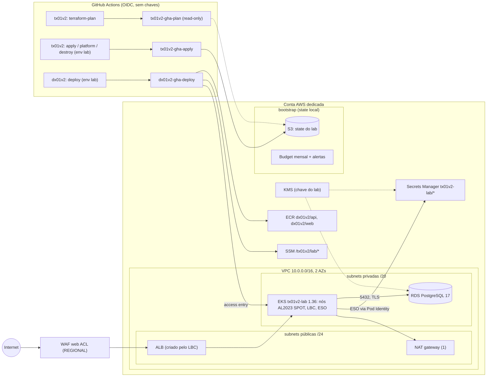
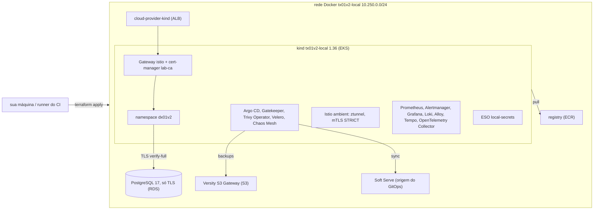

# Arquitetura do tx01v2

> A tabela de decisões e as lições preservam o estado inicial de cada rodada. O escopo
> atual de HA/backup/PITR/DR está em [CONTINUIDADE.md](CONTINUIDADE.md), e capacidade,
> OpenCost/VPA/Spot e estimativa em [FINOPS.md](FINOPS.md). Decisões antigas marcadas
> como fora de escopo não revogam as construções posteriores R7–R10.

Visão da infraestrutura AWS do lab, as decisões por trás dela (ADRs curtos) e o que mudou em relação
ao v1. Nada disto foi aplicado em nuvem na v2 (`não executado em nuvem (v2)`); as decisões estão
cobertas pelos testes e checks citados.

## Diagrama

Camadas: `terraform/bootstrap` (uma vez, por um humano) → `terraform/envs/lab` (módulos `kms`,
`network`, `eks`, `rds`, `ecr`, `waf`) → `platform/` (Helm e manifests, nunca pelo Terraform) →
app do `dx01v2`. O contrato entre as camadas está em `docs/CONTRATO.md`.

## Lab local

A mesma arquitetura emulada no Docker (`terraform/envs/local` + `platform/local`), com a plataforma
completa do v1 por cima. Detalhes, sondas e limites: `docs/LAB_LOCAL.md`.

## Decisões (ADRs curtos)

| # | Decisão | Motivo | Alternativa descartada |
|---|---|---|---|
| 1 | EKS Pod Identity para LBC, ESO e o OpenTelemetry Collector | sem provider OIDC por cluster; trust simples (`pods.eks.amazonaws.com`) limitado por `aws:SourceAccount` e `aws:SourceArn` | IRSA (provider OIDC, trust por `sub` do service account) |
| 2 | Nada de provider `kubernetes`/`helm` no Terraform | o state não depende da API do cluster; destroy não trava em recursos Kubernetes; camadas separadas | Helm via Terraform (acoplamento e destroy frágil) |
| 3 | External Secrets Operator lê o Secrets Manager | segredos ficam na AWS; o deployer nunca escreve Secrets | Secrets criados por pipeline ou CSI driver |
| 4 | Segredos `ephemeral` + argumentos write-only | senha do RDS e token do admin nunca no plan ou no state; rotação por `*_version` | `random_password` (fica no state) ou `manage_master_user_password` (formato de segredo fora do contrato) |
| 5 | Nós SPOT (t3.medium/t3a.medium) e 1 NAT gateway | menor custo por hora; duas famílias melhoram a disponibilidade Spot | ON_DEMAND e NAT por AZ (opcionais via variáveis) |
| 6 | ALB pelo AWS Load Balancer Controller v3.6.0 (Ingress, `target-type: ip`) | integração nativa com WAF, target groups por IP, tags para limpeza; o ingress-nginx foi aposentado em março de 2026 | ingress-nginx + NLB |
| 7 | Access entries (`authentication_mode = API`), sem admin implícito do criador | sem ConfigMap aws-auth nem `system:masters`; acesso declarado e auditável | aws-auth (erro do v1) |
| 8 | `upgrade_policy.support_type = STANDARD` | o padrão do EKS é EXTENDED (US$0,60/h contra US$0,10/h); com STANDARD o cluster recebe upgrade automático no fim do suporte | suporte estendido |
| 9 | Endpoint público restrito por CIDR + privado ligado | runners hospedados pelo GitHub (workflows de plataforma e deploy) e laptops precisam alcançar a API; a autenticação IAM continua obrigatória; `0.0.0.0/0` exige opt-in explícito | endpoint só privado (exigiria runner na VPC, VPN ou bastion) |
| 10 | Uma chave KMS gerenciada pelo cliente | secrets do EKS, RDS, Secrets Manager, ECR e logs com rotação anual e política explícita para o CloudWatch Logs (condição de contexto de criptografia) | chaves gerenciadas pela AWS em cada serviço |
| 11 | Bootstrap separado com state local | cria o que o CI não cria para si mesmo (bucket do state, OIDC, papéis); sobrevive aos destroys do lab | bootstrap pelo CI (precisaria de chaves estáticas) |
| 12 | Budget no bootstrap | alerta mesmo quando o lab não existe e cobre a conta inteira; créditos e reembolsos excluídos para refletir o uso real | budget no lab (sumiria no destroy) |
| 13 | SSM Parameter Store como contrato entre repos | o dx01v2 lê valores em tempo de deploy sem acessar o state; parâmetros String padrão não têm custo | remote state compartilhado (vaza o state inteiro) |
| 14 | `AmazonEKS_CNI_Policy` no papel do nó | padrão do EKS; a rede do nó não depende do agente de Pod Identity no bootstrap; com hop limit 1 só pods hostNetwork alcançam essas credenciais | papel de Pod Identity para o aws-node |
| 15 | Volume raiz gp3 com a chave EBS gerenciada pela AWS | uma CMK no launch template exigiria grant para o service-linked role do Auto Scaling, senão as instâncias não sobem | CMK do lab no EBS |
| 16 | Usuário master do RDS usado pelo app | o lab não roda SQL de provisionamento; menos peças | usuário de app separado (precisaria de provider PostgreSQL ou job) |
| 17 | Lab local com Terraform + provider Docker e kind por CLI (`terraform_data` + `local-exec`) | o mesmo fluxo apply/destroy da nuvem, sem conta; o provider `tehcyx/kind` embute uma versão antiga do kind | LocalStack (AWS emulada parcialmente, imagem Pro para EKS); minikube |
| 18 | Istio ambient no lab local | mTLS e autorização por identidade sem sidecar; roda no kind (no v1 o Autopilot recusou sidecar e ambient) | sidecar (mais memória por pod); Linkerd |
| 19 | GitOps com Argo CD lendo um servidor git do lab | um único dono do namespace do app (v1 tinha dois); o push usa a chave do state, a leitura é anônima | Flux; apontar para o GitHub (exigiria credenciais e internet no caminho do deploy) |
| 20 | Gatekeeper com políticas próprias testadas no `gator` | as regras do v1, em `deny`, com casos que provam aceitação e recusa | gatekeeper-library inteira (mais regras do que o lab explica); Kyverno |
| 21 | Alertmanager → `alert-sink` dentro do cluster; receiver do Slack com o webhook num Secret opcional | entrega de alerta provada sem credencial externa (v1 dependia de um webhook do Slack nunca testado); sem webhook, a mensagem no formato do Slack vai para o sink e a sonda confere o conteúdo | webhook do Slack nos values versionados (v1) |
| 22 | Velero no S3 emulado; objetos e dados de PVC por FSB/Kopia (R9), sem snapshots | o ensaio de restore roda em minutos e sem nuvem (v1 nunca restaurou nada) | `pg_dump` sozinho; snapshots CSI |
| 23 | Perfis `core`/`observability`/`operations`/`full` | máquinas com pouca memória validam uma camada por vez; o CI roda `full` | um único perfil |
| 24 | Traces: o OpenTelemetry Collector como único destino OTLP; Tempo no lab local, X-Ray na nuvem | o app e os Gateways falam só OTLP; trocar o backend não muda o app; Tempo monolítico (chart grafana-community) cabe no kind; o spanmetrics do Collector liga métricas a traces por exemplars | SDK do X-Ray no app (prende o app à AWS); Jaeger; Tempo distribuído |
| 25 | `core` continua padrão; `full` usa Prometheus, Loki e Tempo dentro do EKS | sondas com os mesmos componentes do lab local, sem criar workspaces gerenciados por padrão | AMP + Managed Grafana + CloudWatch |
| 26 | Istio ambient upstream no EKS, com istio-cni encadeado ao VPC CNI | ztunnel por nó, sem sidecar nos pods; as NetworkPolicies liberam HBONE TCP 15008 e as sondas do kubelet | add-on Istio do AKS ou sidecars |
| 27 | Gatekeeper não avalia namespaces gerenciados pelo cluster e pela plataforma; `dx01v2` segue coberto | os controladores precisam subir mesmo com a constraint de namespaces privados | isentar todos os namespaces |
| 28 | Argo CD sincroniza `platform/gitops`; a Application do app lê `gitops/aws` do repositório dx | commit da imagem por digest inicia o deploy; Argo faz self-heal; o repositório público é lido por HTTPS sem credencial | aplicar os manifests diretamente pelo workflow |
| 29 | Velero guarda objetos e dados de volume por FSB/Kopia no S3 (R9); `snapshotsEnabled: false` | drill de restore sem permissões EC2 nem snapshots EBS | snapshots de volume |

Detalhes do LBC v3: desde a v3.0.0 o chart tem a mesma versão do app (chart 3.6.0); o Gateway API
vem habilitado por padrão e é desligado explicitamente (o lab usa Ingress); o service mutator webhook
também fica desligado. A política IAM é a do upstream da tag `v3.6.0`, sem edição.

## R4: plataforma completa em AWS (como código)

O `platform/install.sh --profile core|full` mantém `core` como padrão. `full` acrescenta os mesmos
charts, versões, SHA256 dos archives e digests de imagem do lab local, com overlays AWS. Os renders,
o `kubeconform` e os testes do gator verificam manifests e configuração; nada desta plataforma foi
aplicado na AWS (`não executado em nuvem (v2)`).

### R4.2 — observabilidade no cluster ou gerenciada

Decisão R4.2: o perfil `full` instala kube-prometheus-stack, Loki e Tempo no EKS; `core` continua
instalando só o Collector e enviando traces do app ao X-Ray. O desenho inicial usava `emptyDir` e
perdia histórico com a recriação dos pods. R8.3 substitui esse armazenamento por PVCs gp3 cifrados,
com retenção declarada e teardown dos volumes do lab. Essa durabilidade cobre reinício/recriação do
pod, não a destruição do cluster ou disaster recovery; backups e recuperação em outra região entram
em R9.

A alternativa gerenciada é Amazon Managed Service for Prometheus, Amazon Managed Grafana e CloudWatch
(Logs e traces). A sondagem pode comprovar `remote_write`, consultas PromQL, painéis, alertas, ingestão
de logs/traces e permissões AWS; não comprova a operação nem a retenção dos componentes dentro do
cluster. O custo por rodada fica mais sensível a usuários ativos e volume de telemetria.

Comparação indicativa em `us-east-1`, consulta em 2026-10-16: para uma rodada de 3 horas, dois nós,
1.000 séries por nó coletadas a cada 60 segundos, 1.000 consultas de 100.000 amostras e 1 GB de logs,
o AMP ingere cerca de 360 mil amostras (aprox. US$0,03) e as consultas ficam perto de US$0,01; o
CloudWatch fica em até US$0,50 por GB de logs na hipótese sem crédito de Free Tier; o Managed Grafana
cobra no mínimo US$9 por um editor ativo no workspace no mês, sem rateio por 3 horas. Total indicativo:
cerca de US$9,54 no mês dessa rodada, sem contar transferência e outros dados. Os números de AMP
usam as tarifas publicadas e as quantidades acima; o volume real deve ser medido pelo operador. Fontes:
[preço do AMP](https://aws.amazon.com/prometheus/pricing/),
[preço do Managed Grafana](https://aws.amazon.com/grafana/pricing/),
[preço do CloudWatch](https://aws.amazon.com/cloudwatch/pricing/) (consultados em 2026-10-16).

| Opção (rodada única de 3h) | Estimativa em `us-east-1` | O que as sondas conseguem provar |
|---|---:|---|
| `full` no cluster | ~US$0,88 por rodada de 3h com Spot, incluindo os PVCs gp3 | scrape, alertas, dashboards, logs no Loki e traces no Tempo; dados persistem entre reinícios dos pods, mas não após destroy do cluster |
| observabilidade gerenciada + cluster `core` | ~US$10,32 na primeira utilização do workspace no mês (`3 × US$0,26 + US$9,54`) | `remote_write`, consultas no AMP, dashboards/alertas gerenciados e ingestão no CloudWatch; exercita IAM e APIs da AWS |

Se o workspace do Managed Grafana já teve um editor ativo no mesmo mês, o componente gerenciado
estimado para outra rodada cai para cerca de US$0,54, além do cluster `core`. A hipótese de custo não
inclui tráfego de saída nem volume de traces; eles devem ser somados com o uso real. O usuário é
cobrado por mês de calendário, então não divida a licença do Grafana por horas de uma única sessão.

Para comparar apenas o acréscimo de capacidade do EKS, o perfil `full` pede 1315m CPU e 3680MiB de
memória com dois nós, conforme `scripts/platform-sizing.sh`. Kyverno responde por 520m CPU e 576MiB.
Use `LAB_NODE_INSTANCE_TYPES='["t3.large","t3a.large"]'`
e `LAB_NODE_DESIRED_SIZE=2`; o default `2 × t3.medium/t3a.medium` não é o perfil documentado para
`full`. À tabela base do perfil `core` somam-se aproximadamente US$0,03/h com Spot (estimativa de 35%
do on-demand) ou US$0,0832/h on-demand, usando o preço público de US$0,0832/h do t3.large. Fontes:
[preço do EKS](https://aws.amazon.com/eks/pricing/) e
[preço de instância t3.large](https://docs.aws.amazon.com/prescriptive-guidance/latest/optimize-costs-microsoft-workloads/right-size-selection.html)
(consultados em 2026-10-16). A tabela de `docs/CUSTOS.md` inclui estes valores. O cálculo é de
requests, não de uso observado; o overhead do sistema e a disponibilidade Spot precisam ser
confirmados numa conta do operador.

### R4.3 — Istio ambient no EKS

O `full` usa os charts upstream Istio fixados no lab local. O chart istio-cni instala um plugin CNI
encadeado após o plugin primário, o Amazon VPC CNI; o EKS do lab também ativa NetworkPolicy no VPC
CNI. Portanto as policies do app precisam permitir o túnel HBONE entre nós em TCP 15008 e as sondas
do kubelet no endereço link-local `169.254.7.127/32`, como no overlay local do dx01v2. HBONE usa
TCP 15008 por convenção do Istio e o ztunnel roda em cada nó. Fontes oficiais consultadas em
2026-10-16: [Istio CNI](https://istio.io/latest/docs/setup/additional-setup/cni/),
[Istio HBONE](https://istio.io/latest/docs/ambient/architecture/hbone/) e
[NetworkPolicy no Amazon VPC CNI](https://docs.aws.amazon.com/eks/latest/userguide/cni-network-policy-configure.html).
Os manifests são renderizados; a compatibilidade em execução ainda não foi testada na AWS.

### R4.6 — políticas e componentes da plataforma

O overlay do Gatekeeper isenta `kube-system`, `kube-public`, `kube-node-lease`, `istio-system`,
`cert-manager`, `external-secrets`, `monitoring`, `monitoring-agents`, `observability`, `argocd`,
`trivy-system`, `velero` e `chaos-mesh`, identificando-os pelo label imutável
`kubernetes.io/metadata.name`. O namespace `dx01v2` não é isento e continua com
`policy.lab/enforce: "true"`. `monitoring-agents` e `chaos-mesh` usam Pod Security `privileged`;
`trivy-system` usa `baseline` e alerta `restricted`. No EKS, o scan job usa EKS Pod Identity para
ler apenas os dois repositórios privados do app; nenhum segredo de registry estático é armazenado.
Essa permissão e a configuração do chart são verificadas no Terraform e no render; a instalação real
na AWS continua não executada (v2).

## v1 → v2

| Problema no v1 | Decisão no v2 | Evidência |
|---|---|---|
| Launch template e `disk_size` juntos | volume raiz só no block device mapping do launch template | `policy-terraform`; teste `nodes` (sentinela do mock) |
| Security group próprio no launch template: o EKS deixava de anexar o SG do cluster e os nós não entravam | launch template sem SGs, AMI ou user data | `policy-terraform`; teste `nodes` |
| IMDS com hop limit 2 | IMDSv2 obrigatório, hop limit 1 | teste `nodes` |
| Subnets fixas ignorando variáveis | CIDRs derivados de `vpc_cidr` e AZs de `aws_availability_zones` | testes `network` |
| WAF ligado a um ALB que não recebia tráfego | ACL publicado no SSM e associado pelo Ingress do app (anotação do LBC) | contrato; teste `contract_ssm_parameters_and_wiring` |
| "Testes" que só faziam `echo` | `terraform test` com provider mockado e testes negativos; checks reais no harness | `make test` |
| Terraform 1.6.0 fixado (init falhava: chave da HashiCorp expirada) | `required_version >= 1.11.0, < 2.0.0`; harness com 1.16.5 por SHA256 | `tool-versions`, `version-consistency` |
| Argumentos de CLI do tflint removidos na v0.47 | `tflint --recursive --config` (v0.64.0) | check `tflint` |
| `sed` em arquivos Terraform nos workflows | inputs por `TF_VAR_*`; `sed` em `.tf` proibido | `policy-workflows` |
| Destroy que engolia erros (`\|\| echo`) | destroy falha alto e termina com `scripts/leftovers.sh` | `terraform-destroy.yml`, `policy-workflows` |
| ConfigMap aws-auth + `system:masters` | access entries, modo API | `policy-terraform`; teste `access_entries` |
| Account IDs fixos no código | data sources; placeholders `123456789012`/`<ACCOUNT_ID>` | `policy-identifiers` |
| Só HTTP, mas com claims de HSTS | HTTP 80 declarado; HTTPS apenas com certificado ACM (contrato); nenhuma afirmação além disso | `docs/CONTRATO.md` |
| Senha do RDS em texto no state | `ephemeral "random_password"` + `password_wo`/`secret_string_wo` | teste `rds_password_never_in_plan_or_state` |
| Sem budgets | budget mensal com 4 alertas no bootstrap | teste `budget` |
| Dois NAT gateways fixos | 1 NAT por padrão, um por AZ opcional | testes `network` e `lab` |
| README afirmando coisas que não existiam | matriz de status com rótulos exatos e evidência | `repo-structure`; `README.md` |
